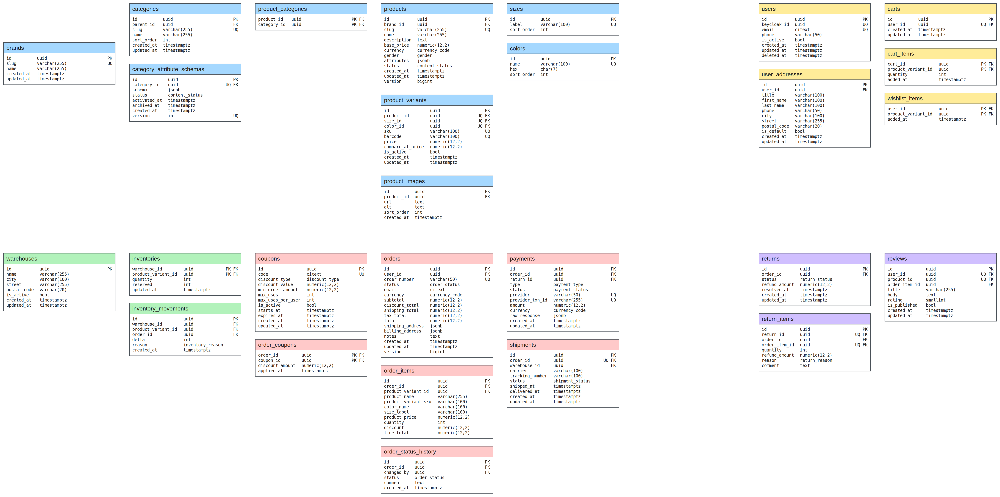

<div align="center">
  
</div>

# 👕 Spring & React Ecommerce

An online clothing store built with Spring Boot and React, with authentication and role management handled by Keycloak.
Browse clothing collections, explore categories, choose sizes and colors, place orders, pay, send items back and leave
reviews.

> 🚧 Work in progress. The database schema is in place; the application itself is still being built.

## ✨ Features

- **Catalog**: products and categories with fast browsing and search
- **Accounts**: sign-in and roles through Keycloak
- **Orders and payments**: from cart to delivery, with every payment tracked
- **Warehouse**: stock levels, so a sold-out product can't be ordered
- **Returns and reviews**: send an item back or rate it after buying
- **Versioned database**: every schema change is a Liquibase migration

## 🧱 Stack

| Part           | Technology                                 |
|----------------|--------------------------------------------|
| Backend        | Java 25, Spring Boot 4, Spring Modulith    |
| Frontend       | React (planned)                            |
| Database       | PostgreSQL 18, schema managed by Liquibase |
| Cache          | Redis                   Initial commit     |
| Authentication | Keycloak                                   |
| Packaging      | Docker Compose                             |

## 🗄️ Data model

Every schema change is a Liquibase migration, split by module: catalog, users, warehouse, orders, returns and reviews,
payments.

<div align="center">
  
</div>

## ⚙️ Configuration

Copy `.env.example` to `.env` and fill it in. Every group has the same four settings: host, database, username and
password.

## 🗂️ Structure

```
spring-react-ecommerce/
├── docs/
├── service-react/
├── service-springboot/
├── docker-compose.yaml
├── .env.example
└── LICENSE
```

---

<div align="center">
  <sub>Built to learn how a real shop works under the hood ;)</sub>
</div>
